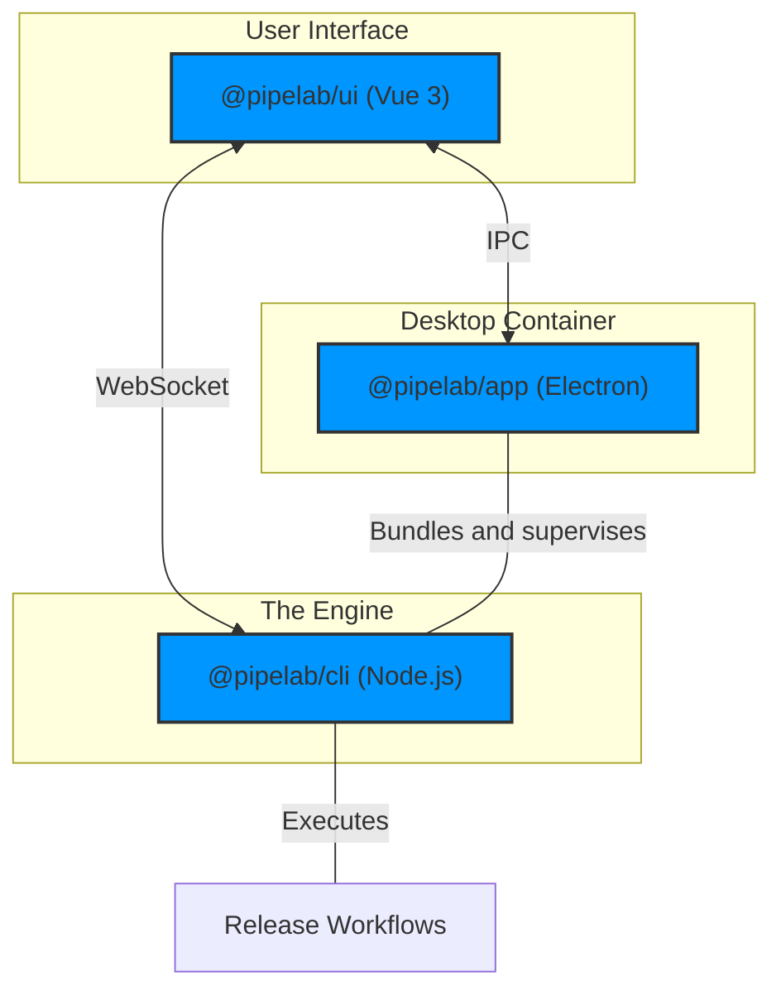

# Pipelab


Pipelab is a desktop app and command-line tool for preparing and shipping game projects. Build Release workflows that take a project (Construct, Godot, Electron, Tauri), produce cross-platform builds, and deliver them to destinations such as Steam, itch.io, and Poki.

## 🏗️ Orchestration Overview

Pipelab is built as a monorepo with three primary application layers that work together to provide a seamless automation experience:



- **The Engine (@pipelab/cli)**: A standalone Node.js server that handles workflow execution, runs provider tasks, and exposes a WebSocket API.
- **The Interface (@pipelab/ui)**: A Vue 3 application that provides the Release workflow editor. It connects to the CLI via WebSockets for real-time execution feedback.
- **The Container (@pipelab/app)**: An Electron wrapper that provides native OS integration (file dialogs, system tray). It bundles the CLI server and runs it as a supervised child process, restarting it (and cleaning up everything it started) if it crashes.

---

## 🛠️ Start Pipelab

### 1. Prerequisites

Tool versions are managed via **mise**. Check [`mise.toml`](mise.toml) for the current requirements (Node 24 and pnpm 10.33.0).

### 2. Environment Configuration

Create a `.env` file in the **root directory**. This is the single source of truth for all packages:

```env
SUPABASE_URL=your_project_url
SUPABASE_PUBLISHABLE_KEY=your_key
PIPELAB_CLOUD_WORKER_URL=https://pipelab-cloud.your-account.workers.dev
POSTHOG_API_KEY=your_key
```

`SUPABASE_URL` and `SUPABASE_PUBLISHABLE_KEY` enable authentication. `PIPELAB_CLOUD_WORKER_URL` configures the Cloudflare Worker used for artifact uploads. `POSTHOG_API_KEY` enables telemetry. The app still starts without them, with the related cloud features disabled.

### 3. Installation

```bash
pnpm install
```

### 4. Development

The fastest way to start the entire ecosystem is from the root:

```bash
pnpm dev
```

> [!TIP]
> This starts the UI dev server and Electron. Electron runs and supervises the CLI server itself, so do not start `@pipelab/cli` separately for the desktop workflow.

The Electron window opens after the UI is available on port 5173. Use `Ctrl+C` in the terminal to stop the development processes.

### 5. Production package

Create a runnable application bundle for the current operating system:

```bash
pnpm package
```

Create an installable distributable instead:

```bash
pnpm make
```

Both commands build the CLI bundle and ship its UI and asset templates with the desktop application; the CLI server code is bundled into `server-entry.js` inside the Desktop app. Forge writes results to `apps/desktop/out/`; `package` creates an unpacked application bundle, while `make` creates the platform-specific installer/archive. Build on each target operating system for its native installer format.

### Useful commands

| Command          | Purpose                                                         |
| ---------------- | --------------------------------------------------------------- |
| `pnpm dev`       | Start the desktop app in development mode.                      |
| `pnpm build`     | Build all workspace packages.                                   |
| `pnpm package`   | Create a production desktop bundle for the current platform.    |
| `pnpm make`      | Create a production installer/archive for the current platform. |
| `pnpm test`      | Run the workspace test suites.                                  |
| `pnpm typecheck` | Run TypeScript checks across the workspace.                     |

---

## 📦 Project Structure

- **`apps/cli`**: The headless engine and WebSocket server.
- **`apps/desktop`**: The Electron lifecycle and IPC handlers.
- **`apps/ui`**: Rendering and visual graph interaction.
- **`packages/*`**: Shared logic, constants, and built-in providers (`packages/providers`: Construct, Godot, Electron, Tauri, Steam, itch.io, Poki).

---

## 🚀 Releases & Versioning

We use **Changesets** to manage versions and changelogs:

```bash
pnpm changeset          # Document a change
```

The release workflow on `main` uses Changesets to open a version pull request.
Desktop, CLI, and UI share one version. Merging the version PR publishes the
bundled CLI to npm, then builds the desktop installers and publishes one
GitHub release for that version. See the
[release runbook](apps/documentation/contributing/releases.md) for setup and recovery.
